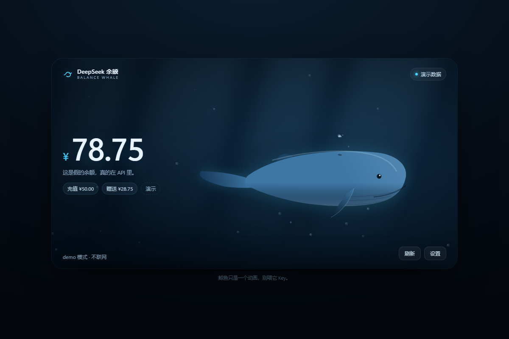
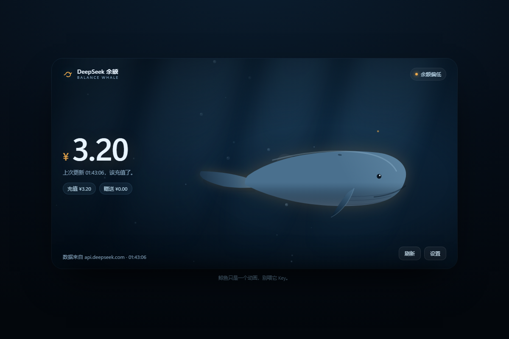
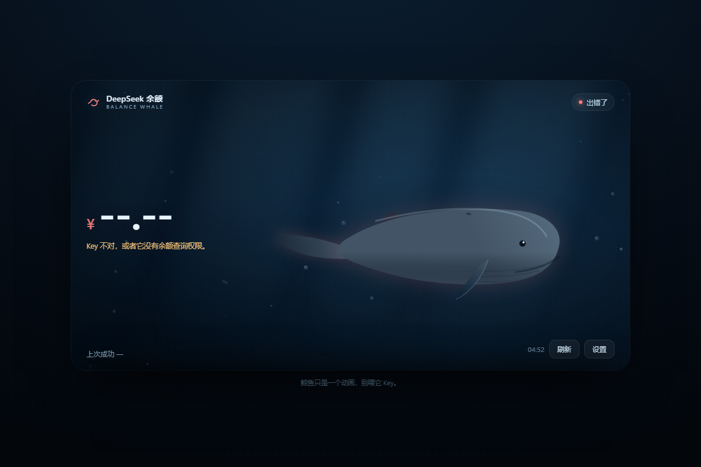
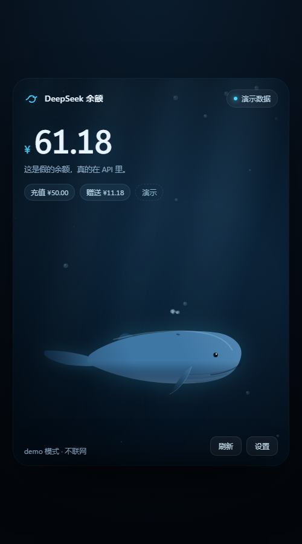

# DeepSeek 余额 · 鲸鱼小部件

一个单文件网页。打开就看到余额，水底下一头鲸在慢慢游。

没有构建、没有依赖、没有后端 —— 双击 `index.html` 就能用。

在线版：**https://adsj-alt.github.io/DeepSeek-Balance-Whale-Widget/**



## 用起来

1. 双击 `index.html`（Chrome / Edge 都行）
2. 右上角「设置」里填 DeepSeek API Key（`sk-` 开头）
3. 点「保存并刷新」，鲸鱼就替你去查一次余额

Key 只存在这台机器的 localStorage 里，**唯一的外发请求**是：

```
GET https://api.deepseek.com/user/balance
```

面板里能看到：总额、充值余额、赠送余额、上次更新时间，以及「距离下次自动刷新」。自动刷新可以在设置里关掉，或者改成 1 / 5 / 15 分钟、1 小时。

## 小动作

- **点鲸鱼** → 喷一口水
- **R** → 立刻刷新（输入框里打字时不会触发）
- **Esc** → 收起设置面板
- 网址后面加 **`?demo=1`** → 演示数据，不联网，适合截图

## 它会怎么变脸

| 状态 | 什么时候 | 长什么样 |
|---|---|---|
| 可用 | 正常 | 青色，鲸鱼蓝蓝的 |
| 余额偏低 | 总额 ≤ ¥5 | 琥珀色，鲸鱼身边一圈暖光 |
| 不可用 | 接口说 `is_available: false` | 红色 |
| 出错了 | Key 不对、网络断了、HTTP 异常 | 红色，鲸鱼褪成灰的 |
| 未连接 | 还没填 Key | 灰蓝，数字是 `--.--` |

几种状态分别长这样：

| 余额偏低 | 出错了 |
|---|---|
|  |  |

手机上会是竖着的版本：



## 关于跨域

浏览器里直接请求 API 是要过 CORS 这一关的。实测 `api.deepseek.com` 会回显请求来源：

```
OPTIONS /user/balance
access-control-allow-origin: <请求的 Origin>
access-control-allow-headers: authorization
access-control-allow-methods: GET
```

用 `file://` 双击打开时 Origin 是 `null`，服务端也照回 `null`，所以**不搭服务器也能查**。这点是用一个假 Key 实测过的 —— 真的收到了 401，说明请求确实发出去了。（真 Key 我没有，所以只能测到这一步。）

万一哪天它改了策略，随便起个本地服务器就行：

```powershell
python -m http.server 8787
```

## 放到 GitHub Pages

已经放好了：仓库 `main` 分支根目录，推送即自动重建 —— https://adsj-alt.github.io/DeepSeek-Balance-Whale-Widget/

自己另开一份的话，整个文件夹推上去，Settings → Pages 里选 main 分支根目录。`index.html` 是全部，没有别的资源要配。

## 文件

```
index.html          ← 全部东西都在这里
screenshots/        ← 上面那几张图
```

## 顺带说几个小毛病

- 报 `401` 就是 Key 不对，或者这个 Key 没有余额查询权限 —— 没有别的可能。
- 连续猛刷可能会被 `429` 挡一下，等几秒就好，没做自动退避。
- 浏览器的 localStorage 被禁掉时 Key 不会记住，当次能查，关了就没。
- 鲸鱼只是动画，不会花你一分钱。

## License

MIT
